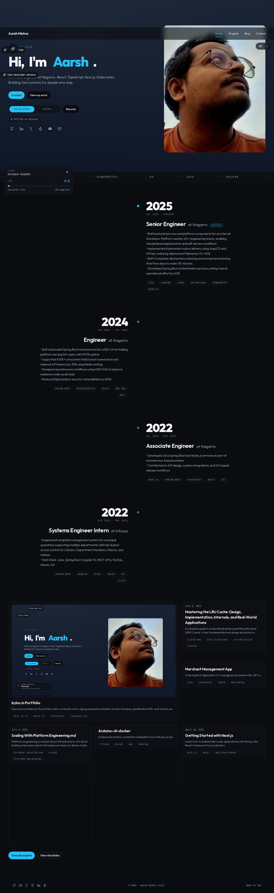
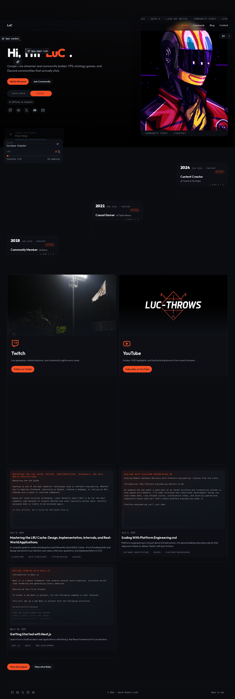

# LuC's Portfolio

A modern, responsive portfolio website built with Next.js, TypeScript, and Tailwind CSS. The site uses a dual persona concept so visitors can switch between developer and gamer profiles with distinct styling, navigation, and content.





> Regenerate these stills any time with `npm run capture:snapshots` (writes `public/ss1.png`, `public/ss2.png`, and the `public/portfolioSS.png` project-card thumbnail).

## Features

- 🌓 **Dual persona toggle** (Developer/Gamer) that reroutes home content, navigation, blog filters, and accent language without a page reload
- 🎬 **Cinematic hero intro overlay** on each fresh page load/reload (portal-mounted so it sits above the game HUD stacking context)
- 🖼️ **Kinetic marquee frame** wrapping the hero portrait — two persona-aware skill / game strips run in opposite directions along the top and bottom of the image at a tight, evenly-spaced rhythm (source list duplicated 3× per half so items pack with a 24px gap instead of being spread across the viewport)
- 🪜 **Staircase experience section** — each career phase is a uniform 19.5rem "step" card that indents further left as you go back in time; a small stick-figure climber (outline head, torso, arms raised in a V) stands on top of each step, and every card wears a `▲ Step N / total` badge so the layout reads bottom-left → top-right as an actual staircase
- 🎯 **Compact-first cards** — the experience descriptions and skills chips are hidden by default and slide open on `:hover` / `:focus-within` via the CSS `grid-template-rows: 0fr → 1fr` trick, so mouse, keyboard, and touch all reach the detail
- 🧩 **Featured bento (3×3)** — developer persona groups all three projects together (byluc.in as a 2×2 anchor top-left plus two 1×1 project cards in the right column) and all three featured blogs together across the bottom row; clicking a project card opens the same rich popup the `/projects` grid uses
- 📺 **Twitch + YouTube channel-banner cards** on the gamer bento with the live channel imagery rendered at `aspect-video` above the CTA
- 🖼️ **Blog cards render a thumbnail whenever the frontmatter includes an `image:` field** — the home featured bento uses an `aspect-video` header image, the `/blog` featured cards use `aspect-[4/3]`, and the `/blog` "More posts" compact rows switch to a horizontal media layout with an 80–96px square thumbnail on the left. Blogs without an image collapse gracefully to text-only
- 🌀 **Scroll-driven reveals via CSS** — `animation-timeline: view()` + a `.reveal-stagger-item` primitive drive the marquee and featured-grid fade-ups off the compositor with no JS scroll handlers (with `@supports` + reduced-motion graceful fallback)
- 🧭 **Landmark scroll snap** — `scroll-snap-type: y mandatory` on `html` with `snap-start` on hero / experience / featured / footer so a real scroll gesture jumps hero → experience directly (marquee frame stays in view as part of the hero)
- 👻 **Hidden native scrollbar** — Firefox `scrollbar-width: none` + Chromium `::-webkit-scrollbar { display: none }` so the dark theme reads clean while wheel / touch / keyboard scrolling still work
- 🕹️ **Gamer HUD**: achievements, class card, floating hints, focus toggle, live Discord status, and Spotify activity card
- 🎨 **Dark theme with persona-specific accent variables**
- 📱 **Responsive App Router pages** for home, blog, projects, contact, and community
- 📝 **Markdown content** for blogs, projects, work experience, gaming experience, and the home-page marquee strings
- 🤖 **Groq AI portfolio chatbot and blog TL;DR summaries with heuristic fallbacks**
- 📬 **Contact form delivery through Telegram**
- 🔎 **Persona-aware blog filtering, keyword search, SEO metadata, structured data, and sitemap routes**
- 🎥 **Reproducible demo pipeline** (`npm run record:demo`) that produces a testreel MP4 + screenshot step log

## Tech Stack

- **Framework**: [Next.js 15](https://nextjs.org/) App Router with [React 19](https://react.dev/)
- **Language**: [TypeScript](https://www.typescriptlang.org/)
- **Styling**: [Tailwind CSS](https://tailwindcss.com/) and [shadcn/ui](https://ui.shadcn.com/)
- **Animation**: [Motion](https://motion.dev/) for keyframe / gesture animation, native CSS **scroll-driven animations** (`animation-timeline: view()`) for scroll reveals, GSAP + ScrollTrigger for pinned scroll pieces, and [Three.js](https://threejs.org/) for the persona backgrounds
- **Icons**: [Lucide Icons](https://lucide.dev/) and React Icons
- **Content**: Markdown/MDX files parsed with [gray-matter](https://github.com/jonschlinkert/gray-matter), `unified`, `remark`, and `rehype`
- **Assistant**: Groq API (`openai/gpt-oss-20b`) with deterministic retrieval and summary fallbacks
- **Operational integrations**: Telegram Bot API for contact messages, Vercel Analytics, and Discord Lanyard status

## Getting Started

### Prerequisites

- Node.js 20 or later
- npm

### Installation

1. Clone the repository:

```bash
git clone https://github.com/LuC-9/custom-portfolio.git
cd custom-portfolio
```

2. Install dependencies:

```bash
npm install
```

3. Create local environment variables:

```bash
cp .env.example .env.local
```

Fill only the values you need for local testing. Chat and summary widgets work without credentials through heuristic fallbacks. Set a server-only `GROQ_API_KEY` to enable AI. Telegram credentials are needed only for contact delivery.

4. Run the development server:

```bash
npm run dev
```

5. Open [http://localhost:3000](http://localhost:3000) in your browser.

## Demo

A production walkthrough of the site ships with the repo:

- **Video**: `demo/portfolio-demo.mp4` (tracked via Git LFS)
- **Screenshot step log**: `demo/steps/*.png` for each captured beat (intro cinematic, persona flip, kinetic marquee, experience timeline, featured work, blog, mobile view)

Regenerate both artifacts locally:

```bash
npm run record:demo
```

The script runs a fresh production build and drives the `testreel` walkthrough against the running app. Global one-time setup is documented in [AGENTS.md](AGENTS.md).

## Environment Variables

| Variable | Required for | Notes |
| --- | --- | --- |
| `TELEGRAM_BOT_TOKEN` | Contact form and chatbot contact tool | Used by `app/api/contact/route.ts` to call Telegram's `sendMessage` API. |
| `TELEGRAM_CHAT_ID` | Contact form and chatbot contact tool | Destination chat for Telegram contact submissions. |
| `GROQ_API_KEY` | Groq AI chat and summaries | Server-only; leave blank for heuristic fallback. |
| `GROQ_MODEL` | Model override | Defaults to `openai/gpt-oss-20b`. |
| `APP_URL` | Hosting/platform metadata | Present in `.env.example`; not required for the active chatbot or contact route. |

There is no active `DISCORD_WEBHOOK_URL` contact path. Contact submissions use Telegram.

## Project Structure

```text
├── app/                         # Next.js App Router pages, API routes, metadata, and sitemaps
│   ├── api/contact/             # Telegram-backed contact endpoint
│   ├── api/portfolio-context/   # JSON context consumed by the chatbot
│   ├── blog/                    # Blog listing, detail pages, audio summary wrapper
│   ├── community/               # Gamer/community page
│   ├── contact/                 # Contact page
│   ├── projects/                # Project listing page
│   └── sitemap*/                # Sitemap index and route handlers
├── components/                  # Reusable UI, chatbot, summaries, persona sections, search
│   ├── intro/                   # Hero intro cinematic overlay (portal-mounted)
│   ├── game/                    # Gamer HUD: achievements, class card, floating hints, focus toggle
│   ├── home-marquee-client.tsx  # Seamless kinetic marquee (used as the frame around the hero portrait)
│   └── home-experience-section.tsx  # Staircase career section with hover-to-expand descriptions
├── contexts/                    # Persona context provider
├── content/                     # Markdown content loaded by lib/content.ts
│   ├── blog/
│   ├── experience/
│   ├── gaming-experience/
│   ├── home/                    # Home-page marquee sources (skills, games)
│   └── projects/
├── hooks/                       # Client hooks (use-intro-gate, use-floating-hint, use-reduced-motion)
├── lib/                         # Content, Telegram, and utility helpers
│   └── content/                 # Small typed loaders for home marquee content
├── public/                      # Static assets
├── demo/                        # Demo pipeline output (MP4 via Git LFS, screenshot step log)
├── app/globals.css              # Global styles and theme variables
└── tailwind.config.ts           # Tailwind and theme configuration
```

## Content Management

`lib/content.ts` is the source of truth for loading content. It reads Markdown/MDX from `content/<type>/`, parses frontmatter with `gray-matter`, renders Markdown to HTML, calculates reading time, and sorts content by `order`, then `date`, then `title` where available.

### Adding Blog Posts

Create a Markdown file in `content/blog/`:

```markdown
---
title: "Your Blog Post Title"
excerpt: "A brief summary of your blog post"
date: "YYYY-MM-DD"
tags: ["Next.js", "React"]
featured: true
audioSummary: "/optional-audio-file.wav"
image: "/optional-image.jpg"
---

Your blog post content in Markdown...
```

Blog search matches title, excerpt, and tags. Persona filtering is tag-based: posts with tags containing `gaming`, `streaming`, `twitch`, `youtube`, `esports`, `games`, or `game` appear in the Gamer filter; other posts appear in the Developer filter.

### Adding Projects

Create a Markdown file in `content/projects/`:

```markdown
---
title: "Project Title"
description: "Brief project description"
image: "/project-image.jpg"
tags: ["Next.js", "Tailwind CSS"]
github: "https://github.com/yourusername/project"
demo: "https://demo-link.com"
featured: true
order: 1
---

Detailed project description in Markdown...
```

Use `order` for deterministic project ordering. Featured project sections read the `featured` flag from frontmatter.

### Adding Work Experience

Create a Markdown file in `content/experience/`:

```markdown
---
title: "Senior Engineer"
company: "Company Name"
period: "Jul 2025 - Present"
skills: ["Java", "Kubernetes", "Argo-CD"]
---

- Describe impact, systems, and measurable outcomes.
```

Experience entries are sorted by `order` when present; otherwise, the start date in `period` is parsed and sorted newest first. Use a `"Month YYYY - Month YYYY"` or `"Month YYYY - Present"` format for predictable sorting.

### Adding Gaming Experience

Create a Markdown file in `content/gaming-experience/`:

```markdown
---
title: "Casual Gamer"
team: "Team Name"
period: "Mar 2021 - Present"
---

Describe the role, communities, platforms, and highlights.
```

Gaming experience uses the same period-sorting helper as work experience.

## Persona Toggle

The global persona state lives in `contexts/persona-context.tsx`. It updates the document with a persona-specific class and CSS variables so pages can switch color themes and content emphasis. Main persona-aware surfaces include:

- `app/HomeContent.tsx` for home-page copy, social links, and featured sections
- `components/navigation.tsx` for developer vs. gamer navigation
- `components/blog-client-page.tsx` for persona-aware blog filtering
- `components/home-experience-section.tsx` and `components/home-featured-section.tsx` for home-page content

## Free AI setup

1. Create a [Groq API key](https://console.groq.com/keys) and keep the account on the **Free Plan**.
2. Add `GROQ_API_KEY` to `.env.local` for development and to your host's server environment for deployment. Never use a `NEXT_PUBLIC_` key. Restart or redeploy after setting it.
3. The default model is `openai/gpt-oss-20b`; `GROQ_MODEL` can override it. No extra SDK is required.

Groq's [Free Plan](https://community.groq.com/t/do-i-get-charged-for-anything-on-the-groq-free-plan/832) rejects requests above quota rather than charging. Its [published limits](https://console.groq.com/docs/rate-limits) currently list 30 requests/minute, 1,000/day, 8,000 tokens/minute, and 200,000 tokens/day for the default model; account-specific limits may differ. These are shared quotas across visitors. Upgrading to Developer enables usage-based billing. The app makes one attempt per generation with a 15-second timeout and falls back without automatic retries.

## Assistant and Contact Workflows

### Chatbot

`components/chatbot.tsx` mounts globally without credentials. `/api/chat` loads server-owned portfolio content and ranks entries using query tokens, weighted titles/tags/skills, and category intent. Answers contain source excerpts and links; unknown questions get an explicit fallback. Groq generates an answer grounded in these excerpts and a bounded portfolio overview. The route accepts only the last six conversational turns and ignores client system prompts and supplied portfolio context. Contact details stay out of AI history. Missing keys, timeouts, rate limits, and provider errors return the deterministic search answer. The UI labels which mode produced the response.

Contact requests start a guided flow: name, valid email, existing reason, message, then explicit send confirmation. `/api/contact` delivers confirmed messages to Telegram. Failed delivery keeps the draft for retry or cancellation.

### Blog summaries

`components/ai-summary-button.tsx` retains its export for compatibility and is always available. `lib/heuristics.ts` strips markup and script/style/code blocks, ranks sentences by term frequency and title relevance, and extracts up to three sentences in source order with a 140-word text budget. The widget requests `/api/summarize`, which asks Groq for up to three bullets under 150 words using at most 12,000 source characters. Provider failures use extractive summaries; browser network failures also use local extraction. The summary sheet labels AI versus extractive output.

### API routes

| Route | Method | Purpose |
| --- | --- | --- |
| `/api/portfolio-context` | `GET` | Returns sanitized project, experience, gaming, and blog data for chatbot context. |
| `/api/contact` | `POST` | Validates `{ name, email, reason, message }` and sends a Telegram message. |
| `/api/chat` | `POST` | Validates messages and returns a Groq answer grounded in server-owned content, or a search fallback. |
| `/api/summarize` | `POST` | Validates content and optional title, then returns an AI or extractive summary. |

## Troubleshooting

| Symptom | Check |
| --- | --- |
| Contact submissions fail | Confirm `TELEGRAM_BOT_TOKEN` and `TELEGRAM_CHAT_ID` are set and that the bot can send messages to the target chat. |
| Blog persona filter shows unexpected posts | Review the post tags. Gamer classification uses simple substring matching against gaming-related tag names. |
| Experience ordering looks wrong | Ensure `period` starts with a parseable month/year, for example `Jul 2025 - Present`. |
| Build succeeds despite type/lint errors | `next.config.mjs` currently sets `typescript.ignoreBuildErrors` and `eslint.ignoreDuringBuilds` to `true`; run local checks before relying on build output. |

## Customization

### Theme Colors

Edit `tailwind.config.ts` and `app/globals.css` to customize light, dark, and persona-specific color schemes.

### Personal Information

Update personal information in:

- `app/HomeContent.tsx` - main profile copy, social links, and persona-specific home sections
- `app/layout.tsx` - site metadata and global layout
- `lib/heuristics.ts` - retrieval, extraction, and social links
- `lib/contact-flow.ts` - guided contact prompts and validation
- `content/` - Markdown-backed projects, blogs, experience, and gaming experience

## Deployment

The app is ready for Vercel or any standard Next.js hosting platform.

1. Configure the environment variables listed above.
2. Build the app:

```bash
npm run build
```

3. Deploy using your platform's Next.js flow.


## License

This project is licensed under the MIT License - see the LICENSE file for details.

## Acknowledgements

- [Next.js](https://nextjs.org/) for the React framework
- [shadcn/ui](https://ui.shadcn.com/) for UI components
- [Tailwind CSS](https://tailwindcss.com/) for utility-first styling
- [Lucide Icons](https://lucide.dev/) for SVG icons
